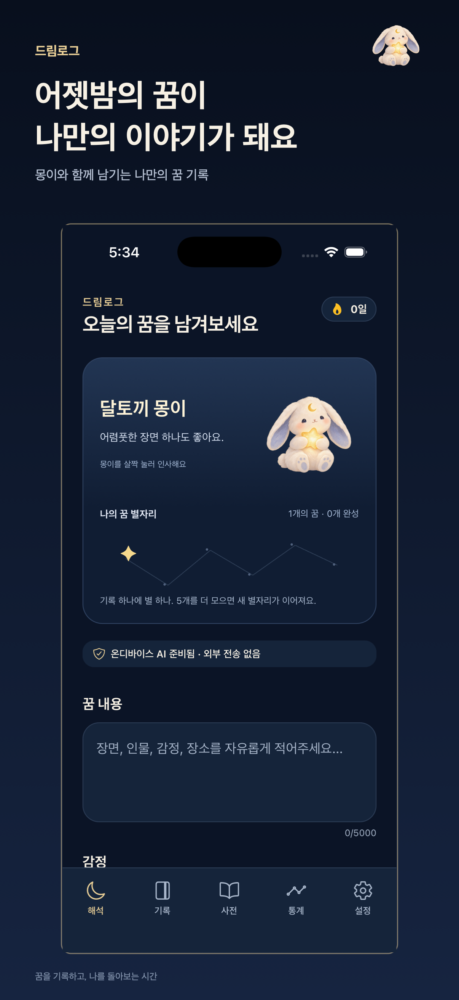
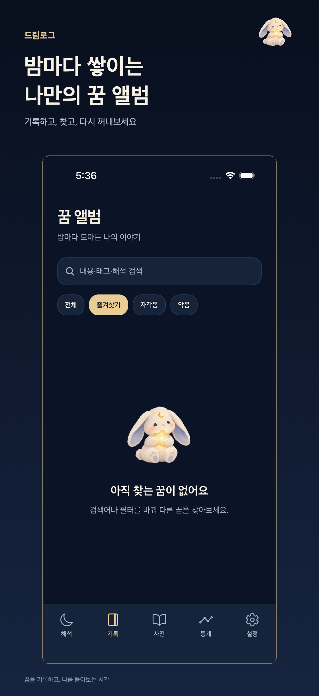
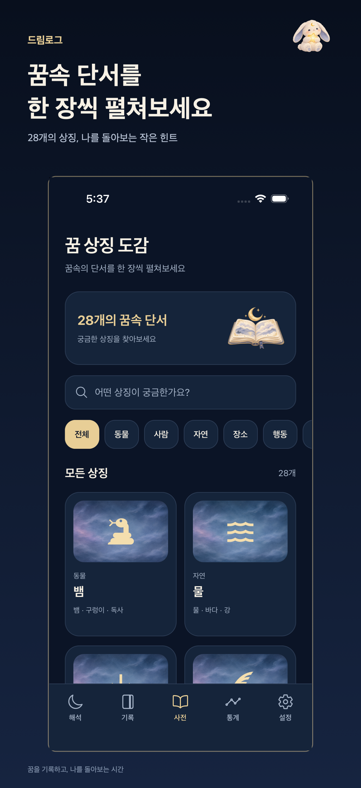
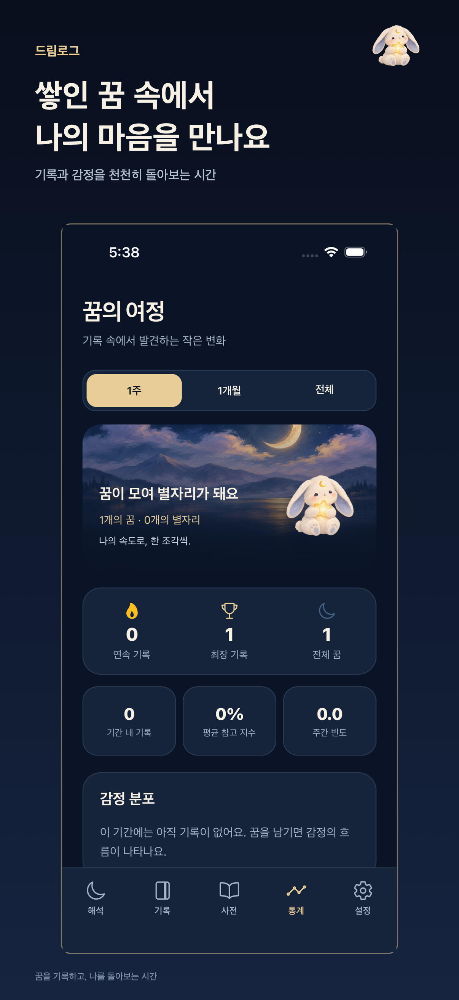

<p align="center">
  
</p>

# 드림로그 · DreamLog

**잊기 전에 한 줄, 다시 보고 싶을 땐 별 하나.**

잠에서 깨면 흐려지는 꿈을 남기고, 쌓인 기록을 나만의 별자리로 다시 펼쳐보는 iPhone·iPad 꿈 일기입니다. 로그인이나 외부 AI 서비스 없이 기록할 수 있어요.

[App Store](https://apps.apple.com/kr/app/id6825689455) · [기능](#주요-기능) · [로컬 실행](#로컬-실행) · [배포 기록](docs/RELEASE_STATUS.md)

## 화면 미리보기

<p align="center">
  
  
  
  
</p>

위 이미지는 실제 iOS Simulator 캡처로 만든 **1.2.0 스토어 미리보기**입니다. 아래 기능 설명은 저장소의 1.2.2 소스 기준이며, 빠른 기록과 별 열기 등 최신 화면은 위 이미지와 다를 수 있습니다. [iPad 미리보기](store-assets/1.2.0/ko/ipad/04-journey.png) · [이미지 제작 기록](store-assets/1.2.0/ko/README.md)

## 주요 기능

- **꿈을 먼저 남겨요.** 해석을 기다리지 않고 저장할 수 있습니다. 쓰던 본문은 기기에 임시 저장되고, 앨범에서 원할 때 같은 기록에 해석을 추가할 수 있어요.
- **별 하나가 꿈 한 편이에요.** 빛나는 별을 누르면 해당 기록이 열립니다. 꿈의 여정에서는 이전에 완성한 별자리도 다시 볼 수 있어요.
- **쌓인 기록을 다시 찾아요.** 검색·태그·즐겨찾기로 꿈을 정리하고, 통계에서 반복되는 키워드를 눌러 관련 꿈을 읽을 수 있습니다.
- **몽이와 꿈의 풍경을 만나요.** 표정이 바뀌는 달토끼 몽이와 타이핑 안내, 꿈의 단서에 맞춰 선택되는 일러스트, 검색 가능한 상징 도감을 담았습니다.

## 기기 안에서 기록하고 해석하기

- **해석:** iOS/iPadOS 26 이상에서 Apple Intelligence 지원 기기의 시스템 모델이 준비되면 Apple Foundation Models를 사용합니다. 미지원·미준비 환경이나 생성 실패 시 기본 해석으로 전환합니다. 별도 API 키나 외부 AI 서버는 필요하지 않습니다.
- **기록과 백업:** 꿈과 임시 본문은 기기 안에 저장됩니다. JSON은 백업·복원용, HTML은 읽기용입니다. 가져올 때 같은 ID는 현재 기록이 우선합니다. 내보낸 파일은 사용자가 관리합니다.
- **해석의 범위:** 상징과 AI 해석은 자기 성찰을 위한 참고입니다. 의료·심리 진단이나 예언이 아니며, 표시되는 참고 지수는 정확도를 뜻하지 않습니다.

[개인정보 처리방침](PRIVACY.md) · [이용약관](TERMS.md) · [지원](https://qlsl1198.github.io/Dream/support.html)

## 로컬 실행

**기본 환경:** Node.js 22. iOS 네이티브 실행에는 macOS, Xcode 26 이상, CocoaPods가 필요합니다.

```sh
npm ci
npm run typecheck
npm test
```

| 목적 | 명령 |
| --- | --- |
| 브라우저에서 UI와 기본 해석 확인 | `npm run web` |
| iOS 네이티브 실행 | `(cd ios && pod install)` 후 `npm run ios` |
| 타입·회귀 테스트와 Expo Doctor 확인 | `npm run verify` |

기술 구성은 **Expo SDK 53 · React Native · TypeScript · AsyncStorage · Swift**입니다. 화면은 [`src/screens/`](src/screens/), 저장과 해석은 [`src/services/`](src/services/), Apple 모델 브리지는 [`ios/DreamInterpreterApp/`](ios/DreamInterpreterApp/)에 있습니다. 동시 기록 저장은 직렬화하며, 읽기 실패 시 기존 기록을 덮어쓰지 않습니다.

> 이 저장소는 `ios/` 프로젝트를 직접 관리합니다. `app.json`의 변경이 네이티브 설정에 자동 반영되지 않습니다. `expo prebuild --clean`은 사용자 정의 브리지를 덮어쓸 수 있으므로 피하세요. 웹과 Expo Go에서는 네이티브 Apple 모델을 검증할 수 없습니다.

## 빌드와 배포

개발과 테스트에는 EAS 클라우드 빌드가 필수가 아닙니다. 배포할 때는 Xcode Archive 또는 기존 EAS 프로덕션 프로필을 사용하세요. EAS에서는 `npm run build:ios`로 빌드한 뒤 대상 버전과 빌드 ID를 확인하고 해당 빌드를 업로드합니다. **바이너리 업로드와 App Store 심사 제출은 별개**입니다.

[출시 체크리스트](STORE_CHECKLIST.md) · [스토어 메타데이터](docs/APP_STORE_METADATA.ko.md) · [배포 상태와 검증 기록](docs/RELEASE_STATUS.md)
